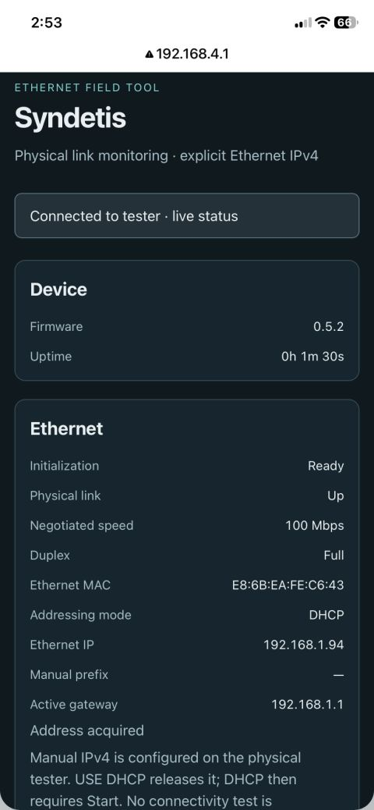
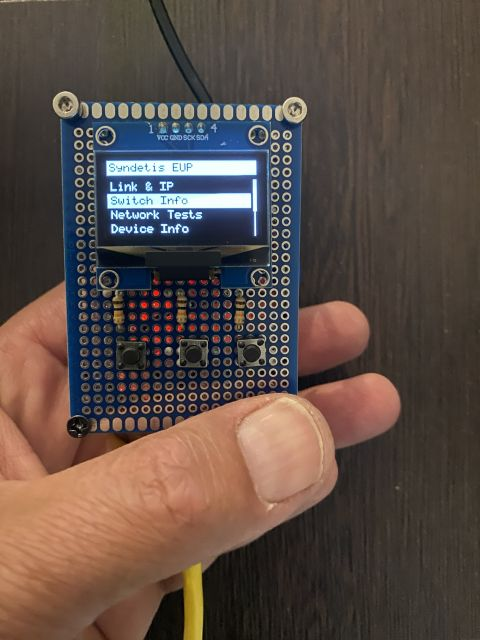
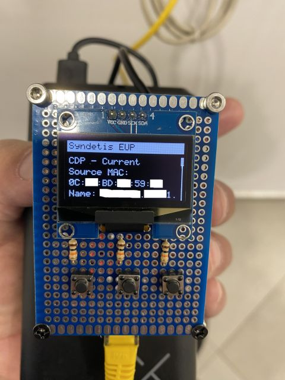

# Syndetis

**A portable Ethernet diagnostic tool, built for troubleshooting in the field.**

Syndetis is a small, ESP32-based project I've been building to make everyday Ethernet troubleshooting a little easier. It combines a wired network interface, a 128×64 OLED display, three buttons, and a local web dashboard in a battery-powered prototype.

The idea is simple: connect to a network port, check what is happening, and get useful information without having to reach for a laptop every time.

**Firmware candidate:** v0.6.0 &nbsp; | &nbsp; **Last hardware-accepted release:** v0.5.2 &nbsp; | &nbsp; **Platform:** WT32-ETH01 / ESP-IDF v6.1

---

## Hardware & Interface Preview


| Field Hardware (Link & IP) | Main Menu |
| :---: | :---: |
|  |  |
| *Physical link up, 100 Mbps full-duplex readout* | *OLED navigation with UP / DOWN / OK buttons* |

| Switch Discovery (CDP) | Local Wi-Fi Web Dashboard |
| :---: | :---: |
|  |  |
| *Passive CDP/LLDP neighbor switch & MAC discovery* | *Live status view on mobile via `192.168.4.1`* |

---

## What it can do

### Ethernet and switch information

- Detect Ethernet link status, negotiated speed (10/100 Mbps), and duplex.
- Discover neighboring equipment through **LLDP** and **CDP**.
- Display advertised switch/device identity, port, and VLAN information when available.
- Listen for neighbor advertisements without starting an IPv4 test.

### Network diagnostics

- Request an IPv4 configuration using **DHCP** and display the IP address, subnet mask, gateway, and DNS servers.
- Configure a temporary **manual IPv4 address**, including ARP conflict detection.
- Ping the gateway or a custom IPv4 address, showing replies, packet loss, and response times.
- Stop, release, and repeat network tests without rebooting the device.

### Local interface and web access

- Navigate the device using a **128×64 OLED** and **UP / DOWN / OK** buttons.
- Enable a local Wi-Fi access point and view Ethernet status, switch discovery information, and DHCP results in a browser.
- Start or stop a DHCP test through the web dashboard.
- Update the firmware over Ethernet or Wi-Fi, with a USB-UART recovery path.

Syndetis is intended for **quick, targeted diagnostics**, not continuous monitoring or comprehensive network scanning.

## Using Syndetis

1. Connect the Ethernet cable to the port you want to inspect.
2. Open **Link & IP** to check the physical connection, speed, and duplex.
3. Open **Switch Info** to see any LLDP/CDP neighbors detected on the link.
4. Use **Network Tests** when you need DHCP, manual IPv4 configuration, or ping diagnostics.
5. Release any active test configuration before moving to another port.

By default, Syndetis does not start an IPv4 diagnostic session until you explicitly request one. Not receiving a ping response does not, by itself, prove that a device is offline.

### Web dashboard

From the device's main menu, select **Web Access → Enable**. Connect to the Wi-Fi network shown on the OLED using the displayed password, then open:

**http://192.168.4.1/**

The dashboard shows live Ethernet information, IP/DHCP state, and discovered switch information. Browser dashboard access is through the device's Wi-Fi hotspot, not its wired Ethernet address.

The prototype dashboard has no separate login once hotspot access is enabled. Use it on trusted networks and disable Web Access when you're finished.

### Diagnostic reports

1. On the OLED main menu, choose **Web Access → Enable** and wait for Web Access to start.
2. Open **Web Access → Connection details** for the hotspot name and password. Join that Wi-Fi network and open <http://192.168.4.1/> in your browser.
3. In the dashboard's **Diagnostic report** section, wait for the first status update, then select **Download diagnostic report** to save a JSON file.

The report includes firmware version and uptime, Ethernet initialization and link status, negotiated speed and duplex, wired addressing mode and state, DHCP status and timing, and LLDP/CDP discovery status, counters, neighbor protocol, TTL, age, and expiry. It includes Ethernet and DHCP error details when available. Ping statistics and device wall-clock timestamps are unavailable in the report.

Network identifiers are omitted by default. Select **Include network identifiers** to include available MAC and IP addresses, subnet, gateway and DNS settings, and switch, chassis, port and VLAN details. These fields can reveal network topology when you share the file.

The report uses the last valid dashboard snapshot and records browser UTC receipt and export times, snapshot age, and whether the data is stale. A failed status poll or a snapshot older than four seconds marks the data stale. You can still download it after disconnecting if the dashboard tab stays open and has received a valid update. Reloading or closing the page discards the cached snapshot.

The OLED **Diagnostic Report** item follows **Settings** in the main menu. It shows the dashboard URL when Web Access is on, asks you to enable Web Access when it is off, and shows **Check Web Access** during startup, shutdown, or an error. Short or held OK returns to the main menu with the item selected. Wi-Fi activation stays in Web Access, and the download happens in the browser.

## Hardware

| Part | Current prototype |
| --- | --- |
| Controller | WT32-ETH01 (ESP32, 4 MB flash) |
| Ethernet | LAN8720 RMII, 10/100 Mbps |
| Display | SH1106 128×64 OLED, I²C |
| Controls | Three buttons: UP, DOWN, OK |
| Power | Portable battery-powered prototype |
| Firmware | C with Espressif ESP-IDF v6.1 |

Current GPIO assignments:

| Connection | GPIO |
| --- | --- |
| OLED SDA / SCL | GPIO32 / GPIO33 |
| UP / DOWN / OK | GPIO36 / GPIO39 / GPIO5 |

The OLED address is detected at `0x3C` or `0x3D`. The authoritative pin mapping and board settings are in [`main/board.h`](main/board.h).

This is still prototype hardware; a custom PCB and enclosure are potential future improvements.

## Building from source

The firmware targets **ESP32** using **ESP-IDF v6.1**, pinned to SDK commit:

`fff9895c82d744c7237be8847347bdd1b07c6643`

Install and activate the appropriate ESP-IDF environment, then run from the repository root:

```bash
idf.py -B build-final build
python3 scripts/verify_build.py build-final
```

The application image is generated at `build-final/Syndetis.bin`.

Linux setup and dependencies are described in [`LINUX_SETUP.md`](LINUX_SETUP.md). On Windows, use an ESP-IDF terminal and the available Python command (`python` or `py -3` instead of `python3`, if needed).

For initial flashing, partition-layout changes, or USB recovery, follow [`RESTORE_USB.md`](RESTORE_USB.md) and the release documentation rather than flashing an old factory image over the current OTA layout.

### Tests

The project contains C host tests, Python verification, Node.js checks, and browser-based tests for the dashboard and updater. With the required toolchain and dependencies installed:

```bash
npm ci --ignore-scripts
npx playwright install chromium
python3 scripts/run_tests.py
python3 scripts/run_ota_crypto_tests.py --idf-path "$IDF_PATH"
python3 tests/ota_identity_test.py --idf-path "$IDF_PATH"
```

See the [release manifest](docs/RELEASE_MANIFEST.md) for recorded build and verification results. These are historical verification records, not a claim that every check has been reproduced in every environment.

## Firmware updates

On the device, open **Settings → Firmware Update** and use one of the following addresses while update mode is active:

| Connection | Update page |
| --- | --- |
| Device Wi-Fi hotspot | `http://192.168.4.1:8080/update` |
| Ethernet (after IPv4 is configured) | `http://<device-ip>:8080/update` |

Upload a trusted, **strictly newer** Syndetis application `.bin` image. The firmware uses two OTA application slots, image validation, and trial-boot rollback.

**Important:** Updates use HTTP without transport encryption or cryptographic authentication of the firmware author. Only use trusted images, a controlled local connection, and stable power during an update. USB recovery details are in [`RESTORE_USB.md`](RESTORE_USB.md).

## Project status

**v0.6.0** is a release candidate pending physical hardware acceptance. It adds JSON diagnostic reports and the OLED Diagnostic Report screen. **v0.5.2** remains the last hardware-accepted release, with user-reported installation and post-flash smoke testing.

For technical details, verification scope, and known limitations:

- [Release manifest](docs/RELEASE_MANIFEST.md)
- [Field acceptance results](docs/FINAL_FIELD_ACCEPTANCE.md)
- [Reliability report](docs/FINAL_RELIABILITY_REPORT.md)

This remains a personal project and a work in progress. Contributions and suggestions grounded in real troubleshooting needs are welcome.

For questions, feedback, or collaboration regarding Syndetis:

**Email:** projects.theo79@gmail.com

You can also open a GitHub Issue for bug reports,
feature requests, or technical discussions.

## License

Syndetis source code is released under the **MIT License**. See [LICENSE](LICENSE).
