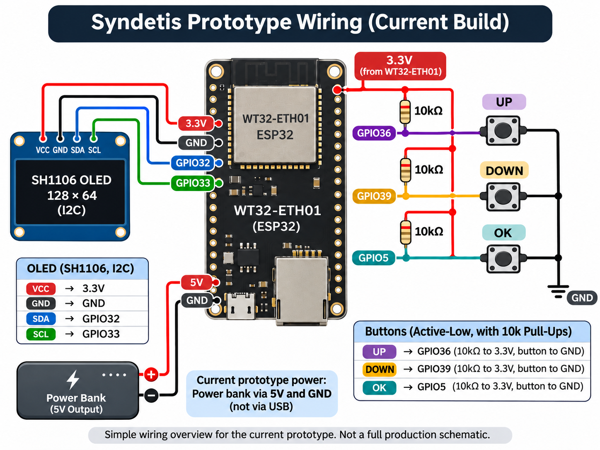

# Syndetis

**An open-source, portable Ethernet diagnostic tool built for troubleshooting in the field.**

Syndetis is a small ESP32-based project designed for network technicians, industrial automation engineers, and anyone troubleshooting wired network connections. It combines a wired network interface, a 128×64 OLED display, three buttons, and a local web dashboard in a prototype powered by a USB power bank.

The idea is simple: connect to a network port, check what is happening, and get useful information without having to reach for a laptop every time.

**Current stable firmware:** [v0.6.0](https://github.com/theo79/Syndetis/releases/tag/v0.6.0) &nbsp; | &nbsp; **Platform:** WT32-ETH01 / ESP-IDF v6.1

---

## Hardware & Interface Preview

| Field Hardware (Link & IP) | Main Menu |
| :---: | :---: |
|  |  |
| *Physical link up, 100 Mbps full-duplex readout* | *OLED navigation with UP / DOWN / OK buttons* |

| Switch Discovery (CDP) | Local Wi-Fi Web Dashboard |
| :---: | :---: |
|  |  |
| *Passive CDP/LLDP neighbor switch & MAC discovery* | *Live status view on mobile via `192.168.4.1`* |

---

## What it can do

### Ethernet and switch information

- Detect Ethernet link status, negotiated speed (10/100 Mbps), and duplex.
- Discover neighboring equipment through **LLDP** and **CDP**.
- Display advertised switch/device identity, port, and VLAN information when available.
- Listen for neighbor advertisements without starting an IPv4 test.

### Network diagnostics

- Request an IPv4 configuration using **DHCP** and display the IP address, subnet mask, gateway, and DNS servers.
- Configure a temporary **manual IPv4 address**, including ARP conflict detection.
- Ping the gateway or a custom IPv4 address, showing replies, packet loss, and response times.
- Stop, release, and repeat network tests without rebooting the device.

### Local interface and web access

- Navigate the device using a **128×64 OLED** and **UP / DOWN / OK** buttons.
- Enable a local Wi-Fi access point and view Ethernet status, switch discovery information, and DHCP results in a browser.
- Start or stop a DHCP test through the web dashboard.
- Export a JSON diagnostic report, with network identifiers omitted by default.
- Update the firmware over Ethernet or Wi-Fi, with a USB-UART recovery path.

Syndetis is intended for **quick, targeted diagnostics**, not continuous monitoring or comprehensive network scanning. The current hardware supports 10/100 Mbps only; it does not measure cable length, certify cabling, or provide Gigabit Ethernet link negotiation. Advertised VLAN information is not a complete VLAN inventory, and discovery depends on the neighboring equipment sending LLDP/CDP advertisements.

## Using Syndetis

1. Connect the Ethernet cable to the port you want to inspect.
2. Open **Link & IP** to check the physical connection, speed, and duplex.
3. Open **Switch Info** to see any LLDP/CDP neighbors detected on the link.
4. Use **Network Tests** when you need DHCP, manual IPv4 configuration, or ping diagnostics.
5. Release any active test configuration before moving to another port.

By default, Syndetis does not start an IPv4 diagnostic session until you explicitly request one. Not receiving a ping response does not, by itself, prove that a device is offline. Use active tests only on networks you are authorized to troubleshoot.

### Navigation

Use UP and DOWN to move through menus, press OK to select, and hold OK for approximately 500 ms to go back. Numeric editors support button repeat.

### Web dashboard

From the device's main menu, select **Web Access → Enable**. Connect to the Wi-Fi network shown on the OLED using the displayed password, then open:

**http://192.168.4.1/**

The dashboard shows live Ethernet information, IP/DHCP state, and discovered switch information. Browser dashboard access is through the device's Wi-Fi hotspot, not its wired Ethernet address.

The prototype dashboard has no separate login once hotspot access is enabled. Use it on trusted networks and disable Web Access when you're finished.

### Diagnostic reports

1. On the OLED main menu, choose **Web Access → Enable** and wait for Web Access to start.
2. Open **Web Access → Connection details** for the hotspot name and password. Join that Wi-Fi network and open <http://192.168.4.1/> in your browser.
3. In the dashboard's **Diagnostic report** section, wait for the first status update, then select **Download diagnostic report** to save `syndetis-diagnostic-report.json`.

The report includes firmware version and uptime, Ethernet initialization and link status, negotiated speed and duplex, wired addressing mode and state, DHCP status and timing, and LLDP/CDP discovery status, counters, neighbor protocol, TTL, age, and expiry. It includes Ethernet and DHCP error details when available. Ping statistics and device wall-clock timestamps are unavailable in the report.

Network identifiers are omitted by default. Select **Include network identifiers** to include available MAC and IP addresses, subnet, gateway and DNS settings, and switch, chassis, port and VLAN details. These fields can reveal network topology when you share the file. Review reports before sharing them.

The report uses the last valid dashboard snapshot and records browser UTC receipt and export times, snapshot age, and whether the data is stale. A failed status poll or a snapshot older than four seconds marks the data stale. You can still download it after disconnecting if the dashboard tab stays open and has received a valid update. Reloading or closing the page discards the cached snapshot.

The OLED **Diagnostic Report** item follows **Settings** in the main menu. It shows the dashboard URL when Web Access is on, asks you to enable Web Access when it is off, and shows **Check Web Access** during startup, shutdown, or an error. Short or held OK returns to the main menu with the item selected. Wi-Fi activation stays in Web Access, and the download happens in the browser.

JSON reports can be opened in a text editor, such as VS Code, or processed with standard JSON tools. On Linux, `python3 -m json.tool syndetis-diagnostic-report.json` prints the report in a readable format.

## Hardware — build your own Syndetis

### Bill of materials (current prototype)

| Qty | Part | Specification |
| ---: | --- | --- |
| 1 | WT32-ETH01 | ESP32, 4 MB flash, onboard LAN8720-family RMII PHY, 10/100 Mbps |
| 1 | OLED display | SH1106, 128×64, I²C, suitable for 3.3V operation |
| 3 | Momentary push buttons | Normally open; UP, DOWN, OK |
| 3 | Resistors | 10 kΩ, one external pull-up per button |
| 1 | Power source | Regulated 5V USB power bank and suitable power leads |
| 1 | USB-UART adapter | 3.3V logic, for initial flashing and recovery |
| As needed | Wiring and assembly materials | Jumper wires, breadboard or prototyping board |
| 1 | Ethernet patch cable | For field testing |

The USB-UART adapter is a programming accessory and does not need to remain attached during normal use. No custom PCB, enclosure, integrated battery charger, or SD card is required for the current prototype. Component prices vary by supplier and region; this is a parts list rather than a fixed-price kit.

Current GPIO assignments:

| Connection | GPIO |
| --- | --- |
| OLED SDA / SCL | GPIO32 / GPIO33 |
| UP / DOWN / OK | GPIO36 / GPIO39 / GPIO5 |

The OLED address is detected at `0x3C` or `0x3D`; automatic probing expects exactly one responding address. The authoritative pin mapping and board settings are in [`main/board.h`](main/board.h).

### Wiring and assembly (current prototype)

The current build uses a WT32-ETH01, an SH1106 128×64 I²C OLED, three active-low navigation buttons, and three external 10 kΩ pull-up resistors. It is powered from a **regulated 5V USB power bank output connected to the board's 5V and GND pins**, not through a USB connector on the WT32-ETH01.



[Open the full-size wiring overview](docs/images/wiring_simple.png)

**OLED connections**

| OLED pin | WT32-ETH01 connection |
| --- | --- |
| VCC | 3.3V |
| GND | GND |
| SDA | GPIO32 |
| SCL | GPIO33 |

**Button connections (active-low)**

Use the following circuit independently for each of the three buttons:

```text
3.3V ──[10 kΩ]──┬── GPIO input
                │
             [BUTTON]
                │
               GND
```

The GPIO connects to the junction between the pull-up resistor and the normally open momentary push button. The resistor connects to the WT32-ETH01's 3.3V rail, not to 5V.

- **Released:** the pull-up holds the GPIO HIGH (3.3V).
- **Pressed:** the button connects the GPIO to GND, making it LOW (0V).
- Use one separate 10 kΩ resistor per GPIO; all three circuits share the board's 3.3V rail and GND.

| Button | GPIO | External resistor | Switch connection |
| --- | --- | --- | --- |
| UP | GPIO36 | 10 kΩ from GPIO36 to board 3.3V | GPIO36 to GND when pressed |
| DOWN | GPIO39 | 10 kΩ from GPIO39 to board 3.3V | GPIO39 to GND when pressed |
| OK | GPIO5 | 10 kΩ from GPIO5 to board 3.3V | GPIO5 to GND when pressed |

Each GPIO input should be held HIGH through its own **10 kΩ pull-up to the WT32-ETH01's 3.3V rail** and pulled LOW by its button when pressed. The three buttons share a common GND return. **Do not connect 3.3V directly to GND when a button is pressed.** GPIO36 and GPIO39 require external pull-ups; the firmware also disables internal pulls for all three buttons.

**Power connections**

| Power-bank output | WT32-ETH01 connection |
| --- | --- |
| Regulated +5V | 5V pin |
| 0V / negative | GND pin |

**Important:** Check the actual WT32-ETH01 module pin labels before making connections; the diagram is a simplified overview, not a pin-position-accurate schematic. Use only a suitable regulated 5V power source on the 5V input, and verify polarity and common ground before powering on. Never apply 5V to a GPIO or the 3.3V rail. GPIO5 is a boot-strapping pin on the ESP32; avoid holding OK during reset or power-up. The present prototype uses a power bank; it has no integrated battery charging circuit.

This is still prototype hardware; a custom PCB and enclosure are potential future improvements.

### First installation and smoke test

1. With power disconnected, assemble the OLED and buttons using the wiring tables above.
2. Obtain the [current firmware release](https://github.com/theo79/Syndetis/releases/tag/v0.6.0) or build the firmware from source as described below.
3. Use a 3.3V-logic USB-UART adapter and follow [`RESTORE_USB.md`](RESTORE_USB.md) and the release documentation for initial flashing. A raw OTA application image alone is not a complete blank-device installation.
4. After flashing, boot normally with the programming strap released. Check that the OLED displays the main menu and that all three buttons respond.
5. Connect to a known working Ethernet port. Check **Link & IP**, then **Switch Info** if the connected equipment advertises LLDP/CDP.
6. On an authorized test network, run DHCP and ping as appropriate, then release the active IPv4 configuration.
7. Enable Web Access, open the dashboard, download a diagnostic report, and disable Web Access when finished.

## Building from source

The firmware is written in C and targets **ESP32** using **ESP-IDF v6.1**, pinned to SDK commit:

`fff9895c82d744c7237be8847347bdd1b07c6643`

Install and activate the appropriate ESP-IDF environment, then run from the repository root:

```bash
idf.py -B build-final build
python3 scripts/verify_build.py build-final
```

The application image is generated at `build-final/Syndetis.bin`.

Linux setup and dependencies are described in [`LINUX_SETUP.md`](LINUX_SETUP.md). On Windows, use an ESP-IDF terminal and the available Python command (`python` or `py -3` instead of `python3`, if needed).

For initial flashing, partition-layout changes, or USB recovery, follow [`RESTORE_USB.md`](RESTORE_USB.md) and the release documentation rather than flashing an old factory image over the current OTA layout.

### Tests

The project contains C host tests, Python verification, Node.js checks, and browser-based tests for the dashboard and updater. With the required toolchain and dependencies installed:

```bash
npm ci --ignore-scripts
npx playwright install chromium
python3 scripts/run_tests.py
python3 scripts/run_ota_crypto_tests.py --idf-path "$IDF_PATH"
python3 tests/ota_identity_test.py --idf-path "$IDF_PATH"
```

See the [v0.5.2 release manifest](docs/RELEASE_MANIFEST.md) for historical build and verification results and the [v0.6.0 release](https://github.com/theo79/Syndetis/releases/tag/v0.6.0) for current release information. Historical results are not a claim that every check has been reproduced for every version or environment.

## Firmware updates

On the device, open **Settings → Firmware Update** and use one of the following addresses while update mode is active:

| Connection | Update page |
| --- | --- |
| Device Wi-Fi hotspot | `http://192.168.4.1:8080/update` |
| Ethernet (after IPv4 is configured) | `http://<device-ip>:8080/update` |

Upload a trusted, **strictly newer** Syndetis application `.bin` image. The firmware uses two OTA application slots, image validation, and trial-boot rollback.

**Important:** Updates use HTTP without transport encryption or cryptographic authentication of the firmware author. Only use trusted images, a controlled local connection, and stable power during an update. USB recovery details are in [`RESTORE_USB.md`](RESTORE_USB.md).

## Project status

**[v0.6.0](https://github.com/theo79/Syndetis/releases/tag/v0.6.0) is the current stable firmware**, published on November 26, 2026, following user-reported hardware testing and successful verification of the downloadable JSON diagnostic report. It adds dashboard JSON diagnostic reports and the OLED Diagnostic Report screen. **v0.5.2** is the previous hardware-accepted version.

The v0.6.0 hardware acceptance is based on the project owner's report, not independent laboratory certification. The historical release manifest and field-acceptance record below document the earlier v0.5.2 acceptance; they should not be interpreted as a complete new hardware acceptance test for v0.6.0.

For technical details, verification scope, and known limitations:

- [Current stable release — v0.6.0](https://github.com/theo79/Syndetis/releases/tag/v0.6.0)
- [Historical v0.5.2 release manifest](docs/RELEASE_MANIFEST.md)
- [Historical v0.5.2 field acceptance results](docs/FINAL_FIELD_ACCEPTANCE.md)
- [Reliability report](docs/FINAL_RELIABILITY_REPORT.md)

## Syndetis V2 — future direction

The goal remains the same: **quick, easy, informative Ethernet diagnostics**. The next hardware generation should keep everyday field tasks simple, even if more advanced features become available.

| Area | Direction |
| --- | --- |
| Display and interface | Larger display and a refined, glanceable interface |
| Portable power | Integrated battery and charging |
| Ethernet | Researching 10/100/1000 Mbps link negotiation, including modular Ethernet hardware alongside an ESP32-based controller |
| Data logging | Optional local storage or SD card logging under consideration |
| Cable diagnostics | Exploring VCT/TDR capabilities where supported by the selected hardware |
| Mechanical design | More compact, field-friendly assembly and enclosure |

V2 is in the research and design stage. No hardware platform, final feature set, price, or release date has been selected. Gigabit link negotiation is a research goal, not a promise of gigabit throughput. Affordability, component availability, power consumption, and ease of replication will guide hardware selection. The current WT32-ETH01 version remains usable independently of this roadmap.

## Feedback and contributions

This remains a personal project and a work in progress. Contributions and suggestions grounded in real troubleshooting needs are welcome. If you build Syndetis or use it in the field, feedback about your hardware, use case, and practical limitations is especially helpful.

For questions, feedback, or collaboration regarding Syndetis:

**Email:** projects.theo79@gmail.com

You can also open a [GitHub Issue](https://github.com/theo79/Syndetis/issues) for bug reports, feature requests, or technical discussions. Remove sensitive network information before posting diagnostic reports publicly.

## License

Syndetis source code is released under the **MIT License**. See [LICENSE](LICENSE).